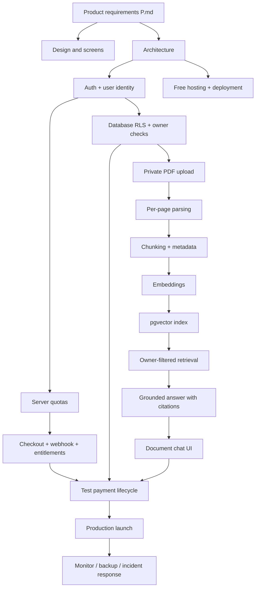

# PROJECT-MAP.md — Documentation navigation and nodes

## Folder tree
```text
AI-PDF-SaaS-Documentation/
├── README.md                 Start guide
├── P.md                      Product requirements
├── A.md                      Application overview
├── ARCHITECTURE.md           System architecture
├── DESIGN.md                 Interface specification
├── ROADMAP.md                Delivery roadmap
├── 00-START-HERE/            Project map / decisions
├── 01-Planning/              Scope, stories, cost/risks
├── 02-Architecture/          Modules, flows, ADRs
├── 03-Design/                Screens, routes, components
├── 04-Database/              Tables, relationships, migrations
├── 05-Backend/               API contracts, function jobs
├── 06-AI-RAG/                PDF extraction, retrieval, prompts
├── 07-Security/              RLS, auth, privacy, threat model
├── 08-Billing/               Plans, payment flow, webhooks
├── 09-Development/           Local setup, sprint checklist
├── 10-Deployment/            FREE DEPLOYMENT and release docs
├── 11-Testing/               QA, security tests, sample scenarios
├── 12-Operations/            Monitoring, backup, incident process
└── 13-Reference/             Env vars, glossary, official links
```

## System nodes (everything connected)


## Document reading route by role
- **Founder/PM:** README -> P -> A -> roadmap -> cost/risks -> launch checklist.
- **Frontend:** DESIGN -> screen map -> API contracts -> auth flows.
- **Backend:** ARCHITECTURE -> schema -> RLS -> API -> AI pipeline -> billing.
- **DevOps:** free deployment -> environment -> launch -> monitoring.
- **QA:** acceptance criteria -> test plan -> security -> billing lifecycle.

## Work tracking convention
Each work item gets an ID like `AUTH-01`, `PDF-03`, `RAG-04`, `BILL-02`, `DEP-05`; include description, dependencies, owner, status and acceptance criteria in GitHub Issues or a tracker.
