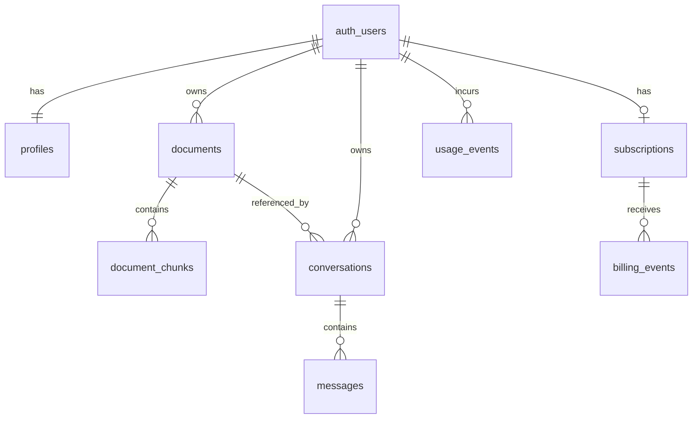

# Database schema — logical model

## Relations

## Tables
- `profiles(id UUID PK -> auth.users, display_name, created_at)`
- `documents(id UUID PK, user_id UUID, name, storage_path, mime_type, bytes, page_count, status, error_code, created_at, updated_at)`
- `document_chunks(id UUID PK, document_id UUID, user_id UUID, page_number INT, chunk_index INT, content TEXT, embedding VECTOR(D), created_at)`
- `conversations(id UUID PK, user_id UUID, document_id UUID, title, created_at)`
- `messages(id UUID PK, conversation_id UUID, user_id UUID, role, body, citations JSONB, created_at)`
- `subscriptions(id UUID PK, user_id UUID UNIQUE, provider, provider_customer_id, provider_subscription_id, plan_code, status, current_period_end, cancel_at_period_end, updated_at)`
- `usage_events(id UUID PK, user_id UUID, event_type, request_key UNIQUE, units, occurred_at)`
- `billing_events(id UUID PK, provider_event_id TEXT UNIQUE, event_type, processed_at, payload_digest)`

## Implementation notes
Use native Supabase `auth.users` (never duplicate password hashes). Supabase SQL RLS for *all* user-facing tables; don't grant direct access to subscription/billing event mutation. Vector dimension `D` must equal the chosen embedding model output dimension; do not invent a dimension before verifying API docs. Embed documents and queries using the **same** model/version/dimension. Index `(user_id,document_id)` and `page_number`. Use migration scripts and backup before alteration.

## Storage
Private bucket `pdfs`; object key pattern `user-id/document-id/original.pdf`. Never trust a client-supplied path for ownership. On delete, remove blob and vectors, retry and reconcile incomplete failures. Metadata may have different retention than PDF content; document the policy.

## SQL starting point
See `04-Database/EXAMPLE-MIGRATION.sql` (reference starter, not a complete production migration).
