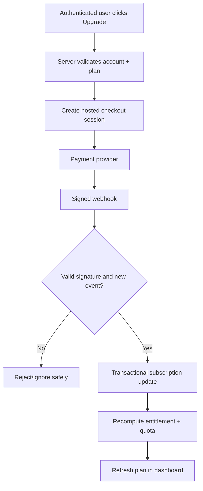

# Subscription strategy, billing nodes and state transitions

## Tiers
Use `free`, `pro` for MVP. Team is later and needs organization-aware schema. Define quotas in trusted server configuration/database, never only in UI.

## Provider choice
Stripe Billing/Checkout is the example **if your business country and account are eligible**. Live onboarding can be restricted by country and merchant approval; if unavailable use a supported provider (e.g., Razorpay for an eligible India merchant) and adapt webhook/event contract. Check subscription/recurring payment support, taxes and mandate rules before promising paid launch.

## Billing graph

## Provider events to support
- Checkout completed: associate provider customer/subscription, but confirm subscription status.
- Subscription created/updated/deleted: authoritative status and period end.
- Payment succeeded/failed: update service access/past-due rule.
- Renewal/cancel-at-period-end: calculate entitlements based on paid period.
- Refund/dispute: operator review and policy-defined access changes.

## Invariants
- Unique webhook event IDs; repeated deliveries must have no additional effect.
- Provider events may arrive out of order; fetch latest subscription state from provider when necessary.
- Map plan by server-maintained price ID; reject unsupported plans.
- No paid entitlement from query params or redirect `success=true`.
- Enforce monthly counters in server transactions; reset using defined billing calendar/time zone (UTC recommended).

## Test checklist
Test checkout success, failure, cancellation, subscription renewal, duplicate webhook, invalid signature, old event after new event, missing user mapping, refund and provider outage. Do it all in sandbox before activating live payment keys.

## Financial reality
Hosted checkout usually has no need to store card details, but transactions and subscription billing are not free to process in production. Tax/invoicing and regional mandates require review.
