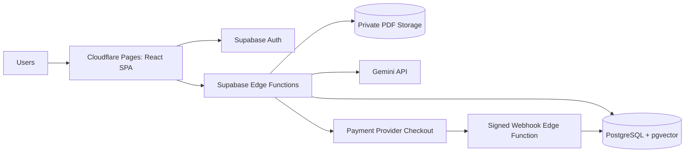
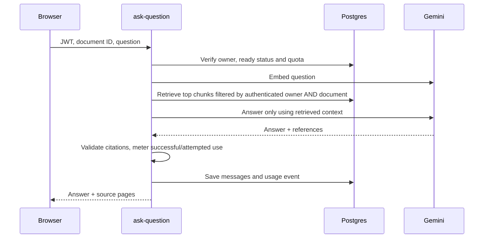

# ARCHITECTURE.md — High-level system design

## Architecture


## Trust boundaries
- Frontend is **untrusted**; published Supabase anon/publishable key may be public; secret/service role keys may not.
- All user-scoped database tables use RLS. Service-role usage, when necessary, stays in server functions and requires explicit owner checks.
- Storage bucket stays private. Server checks ownership before issuing short-lived signed download URLs.
- The ingestion and question-answer functions verify bearer token, UUID ownership and quota, and validate inputs.
- Provider webhook endpoint is publicly reachable but verifies the **raw request body signature** (or provider-specific authenticity mechanism) before updating entitlements.
- Never pass an arbitrary database ID from a client into service-role queries without authorization.

## Upload and ingestion sequence
```mermaid
sequenceDiagram
 participant U as User
 participant B as Browser
 participant F as Edge Functions
 participant S as Storage
 participant D as DB
 participant G as AI Embeddings
 U->>B: Select PDF
 B->>F: Request upload (session, metadata)
 F->>D: Check quota; create owned document row
 F-->>B: Short-lived signed upload URL/path
 B->>S: Upload PDF
 B->>F: Finalize upload (document ID)
 F->>S: Verify path, MIME and actual PDF signature
 F->>D: Set processing with idempotency guard
 F->>F: Extract text + split by page/chunks
 F->>G: Generate embeddings (bounded batches)
 F->>D: Persist chunks and mark ready
 F-->>B: Processing status
```

## Question-answer sequence


## Long-running processing warning
Do not assume a single free Edge Function can ingest arbitrarily large PDFs: runtime, CPU, memory and request limits apply. Start with small text PDFs and synchronous bounded ingestion; for larger jobs, use durable queues/background workers or an appropriately paid service. Status/retry design is included from day one.

## Architectural decisions
- ADR-001: React/Vite SPA instead of server-rendered Next.js to simplify free static hosting.
- ADR-002: PostgreSQL+pgvector for shared relational and semantic storage.
- ADR-003: Per-user isolation via RLS and server-side authorization.
- ADR-004: Hybrid retrieval (vector initially; keyword later).
- ADR-005: Payment provider as source of truth, local subscription as derived entitlement.
- ADR-006: Explicit source IDs and page numbers to prevent invented citations.

## Production scaling triggers
Move ingestion to job queue when timeouts/retries become common; increase database capacity when vectors/indices exhaust free storage; monitor AI usage and provider billing; add structured logs, retry backoff and observability.
